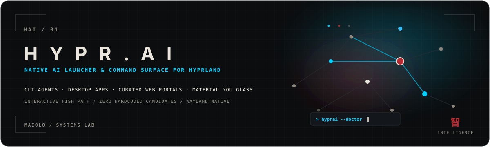
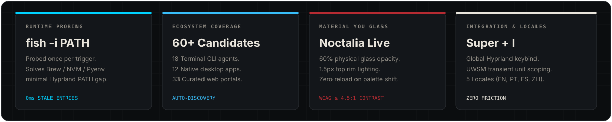
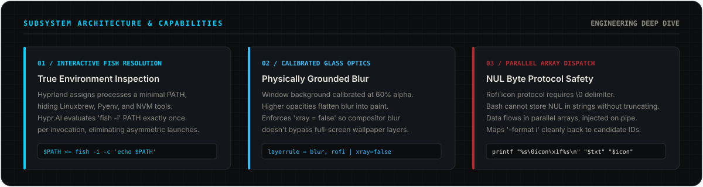
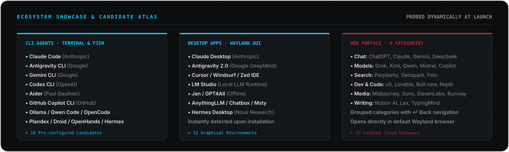
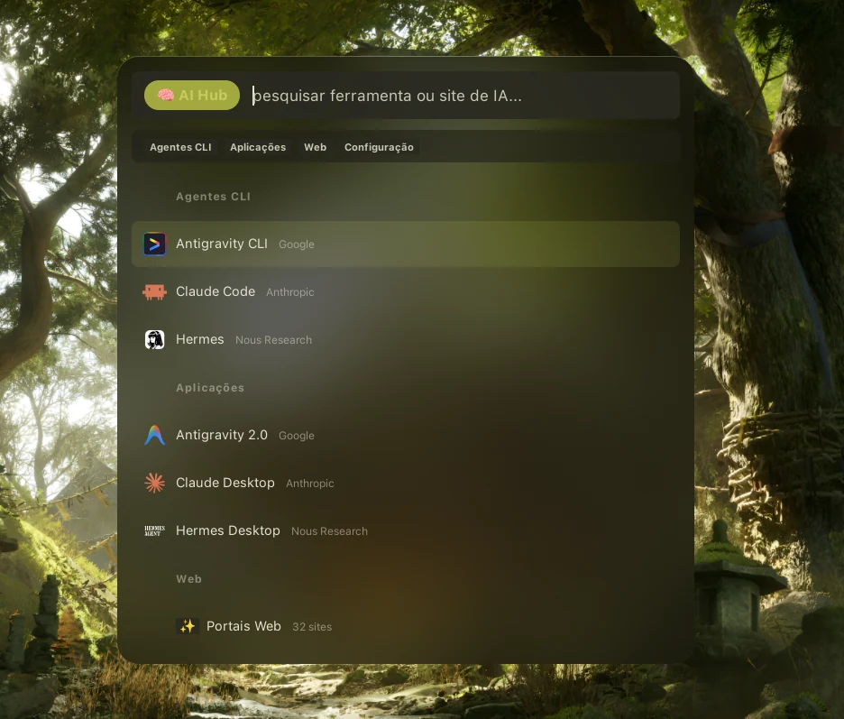
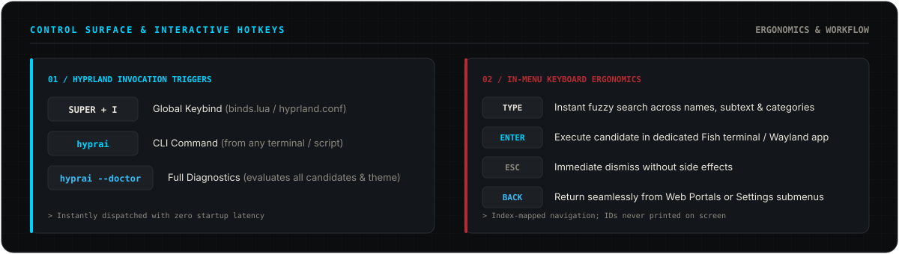
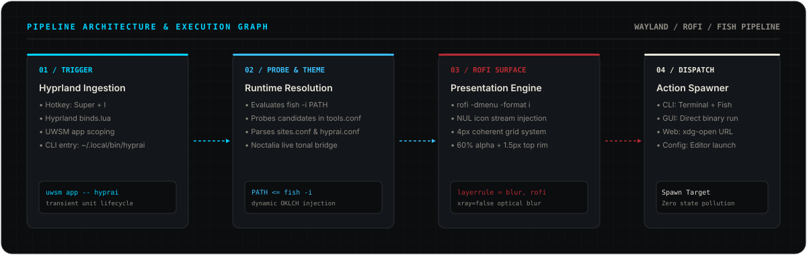
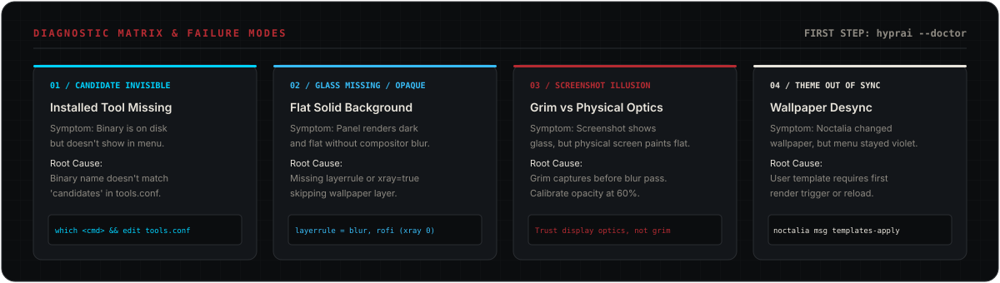
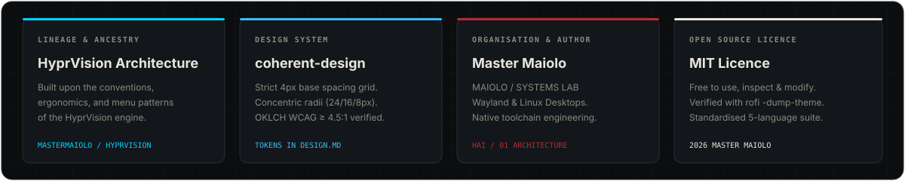

<div align="center">

# HYPR.AI

**Superficie de Comando y Lanzador Nativo de IA para Hyprland**

[](https://github.com/mastermaiolo/hyprai/releases/latest)
[](LICENSE)
[](https://hyprland.org)
[](https://github.com/davatorium/rofi)

<br/>

[English (UK)](README.md) · [Português (Brasil)](README.pt-br.md) · [Português (Portugal)](README.pt-pt.md) · **Español** · [简体中文](README.zh-cn.md)

<br/>



</div>

<br/>

> **Lanzador nativo de IA para Hyprland** — agentes de terminal CLI, aplicaciones de escritorio y portales web seleccionados bajo una interfaz de cristal Rofi accionada por teclado. Nada está prefijado en el código: las herramientas sólo aparecen si están realmente instaladas en tu máquina, y la ventana completa sigue la paleta tonal Material You de tu fondo de pantalla en tiempo real.

---

## 01 / Índice de Navegación

- [02 / De un Vistazo](#02--de-un-vistazo)
- [03 / Capacidades e Ingeniería](#03--capacidades-e-ingenier%C3%ADa)
- [04 / Atlas de Candidatos y Showcase](#04--atlas-de-candidatos-y-showcase)
- [05 / Superficie de Control y Uso](#05--superficie-de-control-y-uso)
- [06 / Requisitos e Instalación](#06--requisitos-e-instalaci%C3%B3n)
- [07 / Configuración y Personalización](#07--configuraci%C3%B3n-y-personalizaci%C3%B3n)
- [08 / Arquitectura del Pipeline y Funcionamiento Interno](#08--arquitectura-del-pipeline-y-funcionamiento-interno)
- [09 / Resolución de Problemas y Diagnóstico](#09--resoluci%C3%B3n-de-problemas-y-diagn%C3%B3stico)
- [10 / Linaje y Procedencia](#10--linaje-y-procedencia)

---

## 02 / De un Vistazo

Hypr.AI elimina la fricción de alternar constantemente entre terminales dispersas, entornos IDE pesados y decenas de pestañas de navegador al orquestar herramientas de inteligencia artificial.

<br/>

<div align="center">
  
</div>

<br/>

### Principales Pilares Arquitectónicos

| Pilar | Implementación Técnica | Garantía Arquitectónica |
|---|---|---|
| **Detección en Tiempo de Ejecución** | Sondeo dinámico de candidatos mediante el entorno interactivo de la shell `fish` | Cero entradas huérfanas; detección automática al instalar o desinstalar |
| **Cristal Material You** | Opacidad de fondo al 60%, bisel superior de 1,5px y puente dinámico con Noctalia | Desenfoque profundo del compositor que replica la paleta del fondo activo |
| **Seguridad de Protocolo** | Transmisión de iconos delimitados por byte NUL directamente en el pipe de Rofi | Preserva archivos SVG y PNG en alta resolución sin truncamiento en Bash |
| **Atajos No Invasivos** | Comprobación previa de colisiones con `hyprctl -j binds` durante la instalación | Registro seguro de `Super + I` sin sobrescribir atajos preexistentes |
| **Soporte Multilingüe (5 Idiomas)** | Resolución automática según el locale del sistema operativo | Soporte nativo para EN-GB, PT-BR, PT-PT, ES-ES y ZH-CN |

---

## 03 / Capacidades e Ingeniería

<br/>

<div align="center">
  
</div>

<br/>

### 1. Resolución del PATH en Fish Interactivo
Bajo Wayland y UWSM, Hyprland ejecuta procesos con un `$PATH` de sistema mínimo (generalmente restringido a `/usr/bin`, `~/.local/bin` y `~/.cargo/bin`). Los entornos gestionados mediante Linuxbrew (`/home/linuxbrew/.linuxbrew/bin`), NVM, Pyenv o asdf suelen residir en `~/.config/fish/config.fish` dentro de bloques interactivos (`if status is-interactive`).

Si un lanzador evalúa candidatos desde una subshell no interactiva estándar, los agentes instalados por Brew o entornos virtuales permanecen invisibles. Hypr.AI solventa esta asimetría consultando a `fish -i` por su `$PATH` consolidado **una sola vez** al abrir el menú, comprobando todos los candidatos en Bash nativo con dicha ruta. Esto elimina el coste de arrancar 30 procesos de Fish y asegura que lo detectado sea exactamente lo que se ejecute.

### 2. Óptica de Cristal Físicamente Calibrada
Lograr un efecto de cristal auténtico en Wayland requiere un ajuste físico milimétrico entre el desenfoque del compositor y la transparencia del panel:
- **Opacidad Calibrada al 60%:** El fondo `bg0` está ajustado al 60% (`#0D0D10` con alpha `0x99`). Por encima del 85%, la luz no atraviesa la superficie y el desenfoque uniforme del compositor se percibe como pintura opaca. Por debajo del 50%, se degrada la legibilidad del texto sobre fondos claros.
- **Bisel Exclusivo en la Parte Superior:** En la física real, una plancha de cristal capta la luz principalmente en su borde superior. Hypr.AI aplica `border: 1.5px 0px 0px 0px`, prescindiendo de marcos cerrados que convierten la ventana en una caja gris de plástico.
- **Regla de Capa con `xray = false`:** En Hyprland, la directiva `xray` ordena al blur omitir las capas intermedias. Sin embargo, en escritorios donde el fondo de pantalla es una capa a pantalla completa (como en Noctalia), `xray = true` salta el propio fondo y el efecto de cristal desaparece de forma invisible. El instalador aplica y valida `xray = false`.

### 3. Protocolo de Arrays Paralelos y Bytes NUL
El protocolo nativo de iconos de Rofi (`-show-icons`) exige un byte NUL puro (`\0`) separando el texto visible de los metadatos del icono (`texto\0icon\x1f/ruta/icono.svg`). Dado que las variables de Bash no pueden almacenar bytes NUL sin truncar la cadena de texto, Hypr.AI organiza los datos en arrays paralelos para etiquetas, identificadores e iconos, emitiendo el byte directamente al pipe de entrada mediante `printf`. El resultado se captura como un índice numérico (`-format i`), traduciendo la acción sin saturar la pantalla con códigos internos.

---

## 04 / Atlas de Candidatos y Showcase

<br/>

<div align="center">
  
</div>

<br/>

### Matriz de Herramientas Compatibles

Hypr.AI incorpora candidatos preconfigurados en tres áreas principales. Las opciones se mantienen ocultas hasta que los binarios correspondientes están presentes en el sistema.

| Área | Herramientas y Nodos del Ecosistema | Modo de Ejecución |
|---|---|---|
| **Agentes de Terminal (CLI)** | Claude Code, Antigravity CLI, Gemini CLI, Codex CLI, Aider, GitHub Copilot CLI, Cursor CLI, OpenCode, Goose, Ollama, Qwen Code, Crush, Mods, Plandex, Droid, OpenHands, Cline, Hermes CLI | Ventana de terminal dedicada (`kitty`, `ghostty`, `foot`, `alacritty` o `wezterm`) ejecutando `fish -i -c "$cmd"` |
| **Aplicaciones de Escritorio** | Claude Desktop, Antigravity 2.0, Cursor, Windsurf, Zed, LM Studio, Jan, GPT4All, AnythingLLM, Chatbox, Msty, Hermes Desktop | Lanzamiento nativo de aplicación gráfica en Wayland |
| **Portales Web Seleccionados** | 33 servicios organizados en Chat, Búsqueda, Redacción, Desarrollo, Código y Multimedia | Navegador predeterminado del sistema (`xdg-open "$url"`) |

<br/>

<div align="center">
  
  <p><em>Hypr.AI en ejecución bajo Hyprland con integración tonal Material You de Noctalia</em></p>
</div>

<br/>

<details>
<summary><strong>Lista Completa de los 33 Portales Web Seleccionados (Haz Clic para Desplegar)</strong></summary>
<br/>

- **Chat y Modelos Base:** ChatGPT, Claude, Gemini, DeepSeek, Grok, Kimi, Qwen, Mistral, Microsoft Copilot, Poe, HuggingChat, DuckDuckGo AI.
- **Búsqueda e Inteligencia:** Perplexity AI, Genspark, Felo, Phind, Consensus.
- **Redacción y Síntesis:** Claude Artifacts, Notion AI, Lex, TypingMind.
- **Desarrollo y Código:** v0 de Vercel, Lovable, Bolt.new, Replit Agent, GitHub Copilot Web.
- **Multimedia y Generación:** Midjourney, Suno, Udio, ElevenLabs, Runway Gen-3, Luma Dream Machine, Flux / Black Forest Labs.

</details>

---

## 05 / Superficie de Control y Uso

<br/>

<div align="center">
  
</div>

<br/>

### Ergonomía de Teclado y Atajos

| Tecla / Comando | Ámbito de Ejecución | Acción Realizada |
|---|---|---|
| `Super + I` | Escritorio Global de Hyprland | Abre o cierra el lanzador Hypr.AI |
| `hyprai` | Terminal / Intérprete de Comandos | Invoca el lanzador directamente desde la consola |
| `hyprai --doctor` | Terminal / Intérprete de Comandos | Ejecuta el diagnóstico exhaustivo del entorno |
| `Escribir para filtrar` | Campo de búsqueda del menú | Filtro fuzzy en tiempo real por nombre, autor y categoría |
| `Enter` | Fila seleccionada | Lanza el agente en la terminal, abre la app o el portal web |
| `Esc` | Dentro del menú | Cierra la ventana al instante sin dejar procesos residuales |
| `↩ Volver` | Submenú de Portales o Configuración | Regresa al menú raíz de herramientas |

---

## 06 / Requisitos e Instalación

### Requisitos Previos

- **Compositor:** Hyprland
- **Motor de Menús:** `rofi` (versión 1.7 o superior con soporte para protocolo de iconos)
- **Shells:** `bash` y `fish` (Fish es indispensable para resolver el PATH interactivo y lanzar agentes CLI)
- **Emulador de Terminal:** `kitty`, `ghostty`, `foot`, `alacritty` o `wezterm` (detectado automáticamente o fijado en `hyprai.conf`)
- **Tipografía:** Familia tipográfica **Inter** (`pacman -S inter-font` en Arch Linux)
- **Marco de Color (Recomendado):** [Noctalia](https://github.com/noctalia-dev/noctalia-shell) o [Caelestia](https://github.com/caelestia-dots/shell) (utiliza la paleta estática Dark Violet / Neon Indigo si ninguno está presente)
- **Paquetes Opcionales:** `libnotify` (notificaciones de escritorio), `uwsm` (gestión de sesiones systemd)

### Instalación Automatizada

```bash
# Clonar el repositorio
git clone https://github.com/mastermaiolo/hyprai.git
cd hyprai

# Ejecutar el instalador
./install.sh
```

### Acciones del Instalador

1. Copia los scripts, esquemas de configuración e iconos en `~/.config/hypr/hyprai/`.
2. Genera el ejecutable wrapper `hyprai` en `~/.local/bin/hyprai`.
3. Registra la plantilla tonal Material You en Noctalia (si está instalado).
4. Comprueba con `hyprctl -j binds` que `Super + I` esté disponible; solicita una tecla alternativa si existe colisión e inserta el atajo de forma limpia entre marcadores `-- hyprai:begin/end` en `~/.config/hypr/config/binds.lua` (o `hyprland.lua`).
5. Pregunta antes de añadir la regla de capa de desenfoque de cristal a tu archivo `windowrules.lua`.

> [!TIP]
> Tras la instalación inicial con Noctalia, cambia de fondo de pantalla o de color de acento una vez para que Noctalia genere el puente de color (`~/.local/state/hyprai/noctalia-colors.rasi`) por primera vez.

---

## 07 / Configuración y Personalización

Todos los ajustes se gestionan en archivos de texto plano dentro de `~/.config/hypr/hyprai/config/`:

| Archivo de Configuración | Propósito |
|---|---|
| `config/tools.conf` | Definición de candidatos para agentes CLI y aplicaciones de escritorio |
| `config/sites.conf` | Portales web de IA seleccionados, agrupados por categorías |
| `config/hyprai.conf` | Preferencias de ejecución (p. ej. `terminal = kitty`, o vacío para autodetectar) |
| `rofi/user.rasi` | Modificaciones visuales personales opcionales (posición, ancho, fuentes) |

> [!IMPORTANT]
> El script `./install.sh` **nunca sobrescribe** tus archivos `.conf` ni tu `user.rasi` al reinstalar. Tu selección y ajustes personalizados se conservan intactos en cada actualización.

### Añadir una Herramienta Local

Añade una línea en `~/.config/hypr/hyprai/config/tools.conf`:

```conf
# id | icono | Nombre | Subtexto | categoría | candidatos | svg | args
miagente|🤖|Mi Agente|Lab Personal|cli|miagente;miagente-cli|miagente.svg|--chat
```

- **`categoría`:** `cli` (se ejecuta en la terminal con fish) o `desktop` (se lanza como aplicación gráfica).
- **`candidatos`:** Nombres de binarios o rutas separados por `;`. Se evalúan en orden; el primero que exista se adopta. Los nombres simples se resuelven en `$PATH`; las rutas absolutas o que comiencen por `~` se verifican directamente.
- **`svg`:** Icono vectorial en `~/.config/hypr/hyprai/svg/` (recurre al emoji de la columna 2 si no se encuentra).
- **`args`:** Parámetros fijos opcionales (útil cuando el mismo comando sirve para modo consola y ventana gráfica).

### Añadir un Portal Web

Añade una línea en `~/.config/hypr/hyprai/config/sites.conf`:

```conf
# id | icono | Nombre | categoría | url | svg
miportal|🌐|Mi Portal|chat|https://ejemplo.ai|portal.svg
```

Categorías disponibles: `chat`, `search`, `write`, `dev`, `code`, `media`.

### Modificar la Posición de la Ventana

Para reposicionar la ventana (por ejemplo, debajo de una barra superior), crea `~/.config/hypr/hyprai/rofi/user.rasi`:

```css
/* ~/.config/hypr/hyprai/rofi/user.rasi */
window {
    location: north;
    y-offset: 120px;
    width: 720px;
}
```

---

## 08 / Arquitectura del Pipeline y Funcionamiento Interno

<br/>

<div align="center">
  
</div>

<br/>

### Distribución del Repositorio

```
hyprai/
├── assets/
│   ├── readme/            # SVGs modulares del sistema de diseño (hero, capabilities, etc.)
│   └── screenshot.webp    # Captura de la interfaz física
├── config/
│   ├── hyprai.conf        # Configuración de terminal y parámetros generales
│   ├── sites.conf         # Portales web seleccionados
│   └── tools.conf         # Candidatos de agentes CLI y aplicaciones de escritorio
├── rofi/
│   └── hyprai.rasi        # Hoja de estilos del tema (rejilla de 4px, radios concéntricos)
├── svg/                   # Colección de iconos vectoriales para el protocolo de Rofi
├── theme/
│   └── noctalia.rasi.tmpl # Plantilla Material You procesada dinámicamente por Noctalia
├── ui/
│   └── launcher.sh        # Orquestador principal y motor de sondeo
├── install.sh             # Instalador idempotente y gestor de atajos
├── uninstall.sh           # Desinstalador limpio y simétrico
├── DESIGN.md              # Especificaciones ópticas y tokens de diseño coherent-design
└── SOBRE.md               # Manifiesto técnico con el razonamiento de ingeniería
```

---

## 09 / Resolución de Problemas y Diagnóstico

Comienza siempre cualquier comprobación ejecutando el comando de diagnóstico incorporado:

```bash
hyprai --doctor
```

`hyprai --doctor` examina las dependencias del sistema, el terminal detectado, el origen del tema activo, las herramientas localizadas, posibles errores de sintaxis, el estado de los atajos y las reglas de capa del compositor.

<br/>

<div align="center">
  
</div>

<br/>

### Situaciones Comunes

<details>
<summary><strong>1. Una herramienta instalada no aparece en el menú</strong></summary>
<br/>

El nombre del ejecutable en el campo `candidatos` de `tools.conf` probablemente no coincide con el de tu sistema.
1. Ejecuta `which <nombre-herramienta>` en una terminal interactiva Fish para verificar la ruta.
2. Comprueba que el nombre figure en la columna `candidatos` de `tools.conf`.
3. El sondeo ignora silenciosamente los fallos para evitar entradas inservibles en el menú. Añade el alias correcto separado por punto y coma (`;`).

</details>

<details>
<summary><strong>2. El menú aparece totalmente opaco, sin efecto de cristal</strong></summary>
<br/>

1. **Regra de Capa Ausente:** Las superficies layer-shell no reciben desenfoque en Hyprland sin una regla explícita que apunte a su namespace. Vuelve a ejecutar `./install.sh` y acepta la regla de cristal.
2. **`xray = true` Activado:** Si la regla incluye `xray = true`, el compositor omite las capas intermedias. Al ser el fondo de pantalla de Noctalia una capa de pantalla completa, el desenfoque salta el propio fondo y el cristal desaparece. Comprueba que la regla tenga `xray = false`.
3. **Opacidad Excesiva:** Si el valor de `bg0` supera el 85%, se bloquea la luz y el fondo desenfocado se percibe como pintura plana. El valor por defecto de Hypr.AI es 60%.

</details>

<details>
<summary><strong>3. La captura de pantalla muestra cristal, pero el monitor físico se ve opaco</strong></summary>
<br/>

Programas como `grim` capturan el buffer de vídeo antes del paso de desenfoque del compositor. Incluso un 5% de transparencia revela el fondo nítido en la captura (que el ojo interpreta como cristal), mientras que la pantalla real muestra una mancha uniforme. La calibración óptica debe realizarse siempre observando directamente la pantalla.

</details>

<details>
<summary><strong>4. Los colores no se actualizan al cambiar de fondo en Noctalia</strong></summary>
<br/>

Noctalia genera las plantillas cada vez que se produce un cambio de fondo o esquema. Si la paleta pierde la sincronización, fuerza la actualización con:
```bash
noctalia msg config-reload && noctalia msg templates-apply
```

</details>

---

## 10 / Linaje y Procedencia

<br/>

<div align="center">
  
</div>

<br/>

### Herencia de Diseño e Ingeniería

- **Arquitectura:** Derivado directamente de los patrones ergonómicos y la arquitectura de menús Wayland de [HyprVision](https://github.com/mastermaiolo/hyprvision).
- **Sistema de Diseño:** Basado en la metodología **coherent-design** — rejilla estricta de 4px, radios concéntricos (ventana de 24px, contenedor de 16px, elementos de 8px) y paleta OKLCH con ratios de contraste WCAG &ge; 4,5:1. Especificaciones completas en [DESIGN.md](DESIGN.md).
- **Autoría:** Master Maiolo · MAIOLO / SYSTEMS LAB.

### Licencia

Este proyecto se distribuye bajo la licencia **MIT**. Consulta el archivo [LICENSE](LICENSE) para acceder al texto íntegro.

---

<div align="center">
<sub>MAIOLO / SYSTEMS LAB · HYPR.AI · SUPERFICIE NATIVA DE COMANDO DE IA PARA HYPRLAND</sub>
</div>
